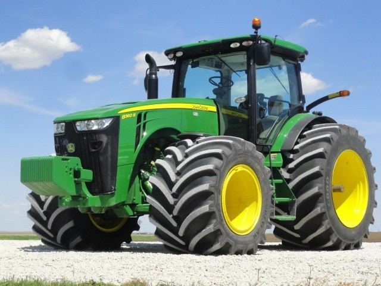
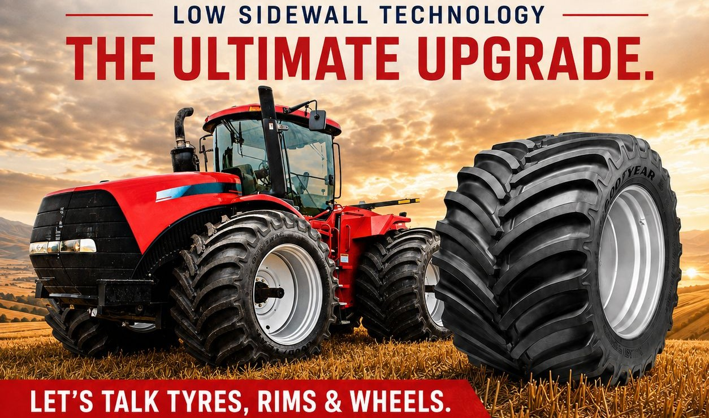
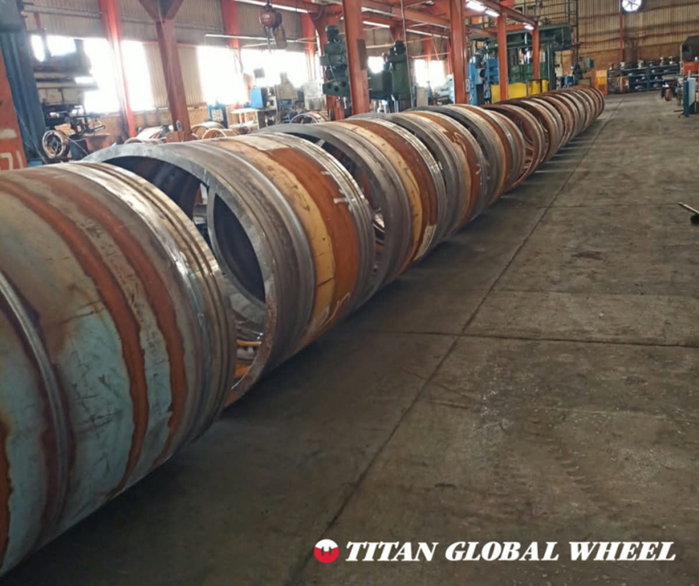
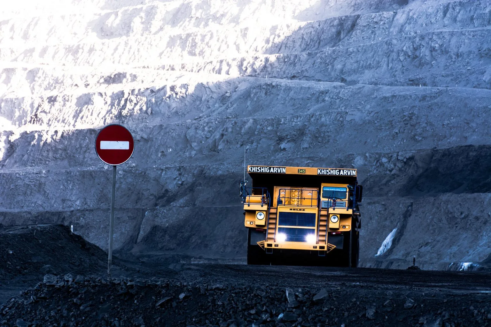

<div align="center">


# Titan Global Wheel — Corporate Website

**The official website of Titan Global Wheel (Pty) Ltd — off-highway tyres, steel & aluminium rims and Tyron runflat systems for agriculture, mining, military and construction across sub-Saharan Africa.**

[](https://www.titanglobalwheel.co.za)
[](https://developer.mozilla.org/en-US/docs/Web/HTML)
[](https://developer.mozilla.org/en-US/docs/Web/CSS)
[](https://developer.mozilla.org/en-US/docs/Web/JavaScript)
[](https://analytics.google.com)
[](src/public/pdfs/ISO-9001.pdf)
[](src/public/pdfs/B-BBEE%20Certificate%20TGW.pdf)

*Est. 1965 · Heidelberg, Gauteng, South Africa · Licensed Goodyear agricultural tyre manufacturer*

</div>

---

## Table of Contents

- [About the Project](#about-the-project)
- [Features](#features)
- [Screens](#screens)
- [Technology Stack](#technology-stack)
- [Getting Started](#getting-started)
- [Deployment](#deployment)
- [Project Structure](#project-structure)
- [Architecture](#architecture)
- [Configuration & Usage](#configuration--usage)
- [Development Guide](#development-guide)
- [Search Engine & AI Discoverability](#search-engine--ai-discoverability)
- [Known Limitations](#known-limitations)
- [FAQ](#faq)
- [Credits & Acknowledgements](#credits--acknowledgements)
- [License](#license)

---

## About the Project

Titan Global Wheel designs, tests and manufactures off-highway tyres, steel and aluminium rims, wheel accessories and Tyron runflat systems. The company has been building wheels since 1965 (founded as Guestro Wheels), is an ISO 9001-certified and B-BBEE Level 2 business, and holds a licence to manufacture Goodyear agricultural tyres for the African market.

This repository contains the company's entire public web presence. It solves a specific problem: a manufacturer selling highly technical products — 63-inch mining rims, LSW (Low Sidewall) tractor tyres, military runflat inserts — needed a website that presents deep product and catalogue data, takes customer enquiries, publishes news, and still loads fast on rural mobile connections. Instead of a heavyweight CMS, the site is a carefully engineered set of **static HTML pages** with a small amount of vanilla JavaScript, so it can be hosted anywhere, indexed perfectly, and edited page by page.

It is designed for Titan's customers (farmers, mine engineers, fleet managers), its dealer network, and the marketing team that maintains it. What makes it different is that every "dynamic" feature — shared navigation, the newsroom, product catalogues, the promotional campaign system — is built with zero build step, zero framework and zero runtime dependencies beyond two third-party embeds.

---

## Features

### Product & Industry Pages

| Page | What it does |
|---|---|
| `index.html` | Corporate homepage: hero, rotating partner-logo banner, product showcase, contact band |
| `products.html` | Overview of every product family (tyres, rims, runflats, accessories) with photography |
| `LSW.html` | Dedicated landing page for Low Sidewall (LSW) tyre technology — cinematic hero, technical explainer, machine guide |
| `rims.html` | Steel & aluminium rims with **searchable, filterable catalogues** (commercial, military, agricultural) in modal detail views, with CSV export |
| `agriculture.html`, `mining.html`, `construction.html`, `military.html` | Industry-specific solution pages |
| `runflats.html` | Tyron Easyfit runflat systems and bead locks |
| `nama.html` | NAMA X/T dual-sidewall on/off-road tyre (24 sizes, 15"–20") |
| `accessories.html` | Wheel components, rim audits and site severity studies |
| `featured.html` | Handpicked heavyweight solutions |

### Services, News & Events

- **`repairs.html`** — the in-house OTR rim repair and re-certification workshop (25"–63" Super Giants), with a photo gallery of sandblasting, MPI testing and repaint work.
- **`news.html`** — the newsroom: newest article featured full-width, article cards, and an embedded Facebook timeline with a direct fallback link.
- **`news2.html`** — the full article archive with seven-per-page numbered pagination.
- **`blog/<slug>/index.html`** — every article published as a clean-URL static page (40+ articles).
- **`events.html`** — agricultural expos and community showcases calendar.
- **`specials.html`**, **`feedback.html`**, **`contact.html`** — tyre specials, a customer feedback form and a full contact/enquiry page.

### Site Chrome (shared across every page)

- **Single-source header and footer** in `js/chrome.js`, injected by `js/partials.js` into `#site-header` / `#site-footer`. Because the chrome is a `<script>`-delivered HTML string rather than a `fetch()`, it also works when pages are opened directly from disk (`file://`).
- **Depth-aware links**: `chrome.js` recomputes the relative `../` prefix at load time, so the identical chrome works at the site root, in `blog/<slug>/`, and in legacy `src/news/articles/` locations.
- **Responsive mobile navigation** (`css/mobile-nav.css`, `js/mobile-nav.js`): a slide-in drawer with dimmed backdrop, scroll lock, focus trap, Escape/overlay closing and an animated Products accordion — active below 980 px.
- **Rotating partner-logo banner** (`css/logo-banner.css`, `js/logo-banner.js`) with proportional logo fitting, edge fade masks, hover pause and `prefers-reduced-motion` support.

### Campaign System: Black November

A self-contained, self-retiring promotional campaign running site-wide:

- **Pop-up** (variant A): auto-opens 2.5 s after load, once per browser session (`sessionStorage`), closes via ✕, outside click or Escape with scroll lock and focus restore; becomes a bottom sheet below 640 px.
- **Sidebar tab**: a slim vertical "BLACK NOVEMBER" tab on the right edge; hides for 7 days on dismissal (`localStorage`); hidden below 1100 px.
- Every CTA deep-links to `specials.html` and fires a GA4 `bn_specials_click` event with a placement dimension.
- **Self-retiring**: `js/promo-bn.js` exits automatically after 30 Nov 2026 23:59 SAST — no emergency deploy needed to end the campaign.
- Excluded by design from `specials.html` itself, policy pages, `404.html`, blog articles and `promo-reel.html`.

### Forms & Analytics

- **Contact and feedback forms** submit via **EmailJS** (SDK v4 from CDN) with a per-input sanitiser that strips HTML, neutralises EmailJS/Mustache template syntax and drops control characters before sending.
- **Google Analytics 4** (gtag.js) on all marketing pages; blog and legacy article pages are intentionally excluded.

### SEO, Accessibility & PWA Basics

- Per-page canonical URLs, Open Graph and Twitter card metadata, `hreflang="en-za"`, and JSON-LD structured data (Organization + LocalBusiness graph).
- `sitemap.xml`, `robots.txt` and `site.webmanifest` with brand theme colours and icons.
- Semantic landmarks, `aria-current="page"` navigation states, `aria-expanded` dropdowns, visible focus states, and reduced-motion support throughout.
- `llms.txt` and `llms-full.txt` — machine-readable site summaries for AI crawlers and agents.

---

## Screens

Real photography from the site (all paths relative to this folder):

<table>
  <tr>
    <td align="center"><br/><sub><b>Homepage hero</b></sub></td>
    <td align="center"><br/><sub><b>LSW tyre technology</b></sub></td>
  </tr>
  <tr>
    <td align="center"><br/><sub><b>Rim repair workshop — MPI testing</b></sub></td>
    <td align="center"><br/><sub><b>Mining wheel systems</b></sub></td>
  </tr>
</table>

> [!NOTE]
> **To-do:** replace this section with real page screenshots (desktop + mobile) once a browser capture pass is done. Suggested captures: homepage at 1440 px, the mobile nav drawer at 390 px, the rims catalogue modal, the Black November pop-up, and a newsroom article page.

---

## Technology Stack

| Layer | Technology |
|---|---|
| Markup | Plain HTML5 — one file per page, no templating at runtime |
| Styling | Vanilla CSS (custom properties, flexbox, grid); no framework, no preprocessor |
| Behaviour | Vanilla JavaScript (ES5-compatible patterns), no bundler |
| Shared chrome | `js/chrome.js` + `js/partials.js` (script-injected HTML, `fetch()`-free) |
| Forms | [EmailJS SDK v4](https://www.emailjs.com/) via jsDelivr CDN |
| Analytics | Google Analytics 4 (gtag.js) |
| Fonts | Archivo (display) & Inter (body) via Google Fonts |
| Media | WebP-first imagery with JPEG/PNG fallbacks; YouTube embeds |
| Clean URLs | Apache `.htaccess` rewrite rules (staged in `htaccess.txt`) |
| Print tooling | Python 3 + [ReportLab](https://www.reportlab.com/) (LOTO tag PDFs — internal, not part of the site) |

There is **no package.json, no build step and no runtime server code**. The site is served as-is.

---

## Getting Started

### Prerequisites

Nothing beyond a browser. Any of the following works:

- Any modern browser (double-click `index.html` — the site is deliberately `file://`-compatible), or
- Any static file server, e.g.:

```bash
# Python 3
python -m http.server 8000

# Node (if you have npx available)
npx serve .
```

Then open <http://localhost:8000>.

### Notes for local development

- Pages under `blog/<slug>/` and `src/news/articles/` resolve their own depth at runtime, so relative links and the shared chrome work from any location.
- The `.htaccess` rules (clean URLs, `.html` stripping, trailing-slash removal) only take effect on an Apache host — locally you use the `.html` filenames directly.

---

## Deployment

The production site is **fully static**. Deploy the contents of this folder to any web server or static host (Apache, cPanel, Netlify, Cloudflare Pages, S3, etc.).

For the production Apache host, promote `htaccess.txt` to `.htaccess` at the web root. It provides:

```apacheconf
# 301 index.html → clean directory URL
# 301 /page.html → /page
# /contact-us → /contact
# trailing-slash removal (except /blog/)
# internal rewrite so /page serves page.html
```

After deployment, verify:

- [ ] `https://www.titanglobalwheel.co.za/sitemap.xml` resolves
- [ ] Clean URLs work (`/about`, not `/about.html`)
- [ ] Contact and feedback forms deliver through EmailJS
- [ ] GA4 receives page views and `bn_specials_click` events (if the campaign is live)

---

## Project Structure

```text
Website/
├── index.html                  # Homepage
├── products.html               # Product family overview
├── LSW.html                    # LSW tyre technology landing page
├── rims.html                   # Rims + searchable catalogues (modals, CSV export)
├── accessories.html            # Wheel components, rim audits
├── runflats.html               # Tyron Easyfit runflat systems
├── nama.html                   # NAMA X/T tyre
├── agriculture.html            # Industry: agriculture
├── mining.html                 # Industry: mining
├── military.html               # Industry: military & defence
├── construction.html           # Industry: construction
├── repairs.html                # OTR rim repair workshop
├── featured.html               # Featured heavyweight solutions
├── news.html                   # Newsroom (Facebook embed + newest articles)
├── news2.html                  # Article archive with pagination
├── events.html                 # Events calendar
├── specials.html               # Tyre specials
├── contact.html                # Contact + EmailJS enquiry form
├── feedback.html               # Customer feedback form (EmailJS)
├── 404.html                    # Custom not-found page
├── Privacy-Policy.html         # Privacy policy
├── Cookies-Policy.html         # Cookies policy
├── promo-reel.html             # Fullscreen promo reel (no chrome)
├── black-november-preview.html # Campaign design reference (noindex)
├── localsitecompare.html       # Internal site comparison tool
├── SEO-Performance-Report.html # Internal SEO audit report
│
├── blog/<slug>/index.html      # 40+ articles as clean-URL static pages
│
├── css/                        # Site styles
│   ├── site.css                # Core layout, typography, components
│   ├── site-chrome.css         # Shared header/footer styles
│   ├── mobile-nav.css          # Mobile drawer navigation
│   ├── logo-banner.css         # Partner logo banner
│   ├── news.css                # Newsroom & archive
│   ├── lsw-page.css            # LSW landing page
│   ├── promo-bn.css            # Black November campaign
│   └── site-overrides.css      # Cross-page fixes
│
├── js/
│   ├── chrome.js               # Single source of header & footer HTML
│   ├── partials.js             # Injects chrome, marks active nav, wires dropdowns
│   ├── mobile-nav.js           # Mobile drawer behaviour
│   ├── logo-banner.js          # Rotating logo banner
│   ├── news-index.js           # Newsroom listing & pagination
│   ├── articles.js             # Article page behaviour
│   └── promo-bn.js             # Black November pop-up + sidebar (self-retiring)
│
├── partials/                   # Static copies of header/footer (reference)
├── blog/                       # Article pages (one folder per slug)
├── src/                        # All media & downloadable assets
│   ├── logos/                  # Brand logos, favicon
│   ├── logo banner/            # Partner logos (+ transparent variants)
│   ├── homepage/               # Hero & section imagery (WebP-first)
│   ├── news/                   # News images + legacy article sources
│   │   └── articles/           # Article sources + _template.html + README
│   ├── agti tyres/             # Agricultural catalogues (PDF)
│   ├── construction tyres/     # OTR load/inflation tables (PDF)
│   ├── military tyres/         # Military spec sheets (PDF)
│   ├── accessories/pdfs/       # Haltec catalogue
│   ├── public/pdfs/            # ISO 9001 & B-BBEE certificates
│   ├── repairs/                # Workshop gallery
│   ├── rims/                   # Rim catalogue sub-pages (agri, commercial, earthmover, military)
│   ├── lsw/, nama/, runflats/, products/, promos/   # Product media
│   └── otr/                    # OTR media
│
├── loto-tags/                  # Internal print project (not part of the site)
│   ├── build/build_loto_pdfs.py
│   └── print/                  # Generated tag PDFs + QA renders
│
├── htaccess.txt                # Apache rewrite rules (promote to .htaccess)
├── robots.txt                  # Crawler rules (dev artifacts disallowed)
├── sitemap.xml                 # XML sitemap
├── site.webmanifest            # PWA manifest
├── llms.txt / llms-full.txt    # AI/agent-readable site summaries
└── CHANGELOG.md                # Dated change log
```

---

## Architecture

### How the shared chrome works

The header and footer exist in exactly one place: `js/chrome.js`, which exposes them as `window.TGW_CHROME`. `js/partials.js` injects them into each page's `#site-header` / `#site-footer` mount points, marks the active nav item with `aria-current="page"`, and wires dropdown + mobile drawer behaviour.

```html
<!-- On every page, before </body>: -->
<script src="js/chrome.js"></script>
<script src="js/partials.js"></script>
```

The decision to use a script-delivered HTML string instead of `fetch()` is deliberate: `fetch()` fails on the `file://` protocol, so this design lets the marketing team double-click any page from disk and see the fully-chromed site with no server.

### Depth-aware linking

Links inside the chrome are written with a `../../../` prefix. At load time `tgwPagePrefix()` computes the real prefix from the current page's depth relative to the script's own URL, so one chrome serves three page depths:

| Page location | Depth | Computed prefix |
|---|---|---|
| `/index.html` | 0 | *(empty)* |
| `/blog/<slug>/` | 2 | `../` × 2 |
| `/src/news/articles/x.html` | 3 | `../` × 3 |

### The news pipeline

Each article lives as a self-contained HTML file. Sources sit in `src/news/articles/` (built from `_template.html`), and the published copies live in `blog/<slug>/index.html` with a matching clean URL. Article metadata (`<title>`, `<time datetime>`, `data-related-*`, meta description, `og:image`) is read directly from the page markup, and the "related articles" data blocks are inlined into each article page so they work even without a server. The editorial workflow is documented in [`src/news/articles/README.md`](src/news/articles/README.md).

### Campaign isolation

The Black November campaign touches pages through only two shared files (`css/promo-bn.css`, `js/promo-bn.js`) plus a three-line tag per page — and `promo-bn.js` hard-exits after the campaign end date, so expiry requires no redeploy.

### Design tokens

Brand colours and typography are consistent site-wide: navy `#114172`, red `#E01030`, steel `#5B8BD0`, dark `#0A0D10`, with **Archivo** for display type and **Inter** for body text.

---

## Configuration & Usage

There are no environment variables and no build configuration. The few external services are configured in-page:

**EmailJS** (contact + feedback forms) — the SDK is initialised in each form page's `<head>` with the public key; the service and template IDs live in the form handler at the bottom of `contact.html` / `feedback.html`:

```js
emailjs.init({ publicKey: '<public key>' });   // in <head>
// ...in the submit handler:
emailjs.send('<service id>', '<template id>', payload)
  .then(function () { /* success state */ })
  .catch(function (error) { console.error('EmailJS Error:', error); });
```

**Google Analytics** — the GA4 measurement ID (`G-D07TXJ8J69`) is set in the gtag snippet at the top of every marketing page.

**Campaign window** — the Black November end date is a constant inside `js/promo-bn.js`; adjust it there if the campaign is extended.

**Session / dismissal keys** used by the campaign (do not reuse these names):

| Key | Storage | Purpose |
|---|---|---|
| `tgw_bn_popup_seen` | `sessionStorage` | Show the pop-up once per browser session |
| `tgw_bn_sidebar_until` | `localStorage` | Keep the sidebar hidden for 7 days after dismissal |

---

## Development Guide

There are no npm scripts, test runners or linters configured for the website itself — edits are direct HTML/CSS/JS changes. The practical workflow:

1. **Serve locally** (`python -m http.server 8000`) or open files directly from disk.
2. **Edit the page** you need. Never copy a header/footer into a page — the chrome comes from `js/chrome.js`.
3. **New article?** Copy `src/news/articles/_template.html`, fill the `TODO:` markers (title, meta description, hero image in `src/news/images/`, date, `data-related-*` attributes), then publish to `blog/<slug>/index.html`. See [`src/news/articles/README.md`](src/news/articles/README.md) for the full checklist.
4. **Add the page to** `sitemap.xml` and, if it is a permanent public page, to `llms.txt` and the `robots.txt` allowlist comment.
5. **Log the change** in `CHANGELOG.md` with the date.

### House rules (enforced by convention)

- Every page shares the identical navbar and footer — only the active-page highlight differs.
- Every page must be fully responsive on mobile and tablet (breakpoint: 980 px for the nav).
- Keep the visual style (colours, fonts, hero pattern) consistent across all pages.

### Known issue to avoid

Responsive overrides must appear **after** their base rules in the cascade — an events-page bug where overrides sat before base styles caused a 99 px horizontal overflow on phones (fixed 2026-09-30; see `CHANGELOG.md`).

---

## Search Engine & AI Discoverability

- **`sitemap.xml`** — full page list; update when pages are added or removed.
- **`robots.txt`** — allows all public pages, blocks dev artifacts (`original-index.html`, backup files, tooling paths) and points to the sitemap.
- **`llms.txt` / `llms-full.txt`** — structured summaries of the company, products, services and contact details written for AI models and agents, in the emerging [llms.txt](https://llmstxt.org) convention.
- **Structured data** — JSON-LD `Organization`/`LocalBusiness` graph on the homepage; article metadata on news pages.

---

## Known Limitations

- **No build system or test suite** — correctness relies on review and manual QA across pages.
- **Chrome duplication in older pages** — some legacy pages still carry inline header/footer markup; the shared-chrome migration is ongoing.
- **Backup files committed** — `original-index.html`, `industries - Backup.html` and `rims - backup.html` are historical references (excluded from indexing via `robots.txt`).
- **`generate-news.cjs` is not committed** — the article index/manifest rebuild script referenced by the news README is not present in this repository; article publishing is currently done by copying pages into `blog/<slug>/`.
- **Client-side-only forms** — enquiry delivery depends on EmailJS availability; there is no server-side fallback.
- **Large source media** — `src/` contains full-resolution originals and catalogues (some PDFs > 10 MB) plus a ~47 MB `src/news/images.zip`; keep this in mind for clone size and deploy bandwidth.

---

## FAQ

<details>
<summary><b>Can I open the site without a server?</b></summary>
Yes. The shared chrome is injected via script tags rather than <code>fetch()</code>, so double-clicking <code>index.html</code> works, including blog articles and related-article blocks.
</details>

<details>
<summary><b>How do I change the navigation or footer?</b></summary>
Edit <code>js/chrome.js</code> (the single source) and, for static reference copies, <code>partials/header.html</code> / <code>partials/footer.html</code>. Never edit per-page header markup.
</details>

<details>
<summary><b>Where do form submissions go?</b></summary>
Through EmailJS, using the service and template configured in <code>contact.html</code> and <code>feedback.html</code>. Both forms sanitise input client-side before sending.
</details>

<details>
<summary><b>What happens when the Black November campaign ends?</b></summary>
<code>js/promo-bn.js</code> checks the date on every load and exits without injecting anything. Removing the three-line tags per page is optional cleanup.
</details>

<details>
<summary><b>What are the company's certifications?</b></summary>
ISO 9001 (design, testing, production) and B-BBEE Level 2 — certificates are published under <code>src/public/pdfs/</code>.
</details>

---

## Credits & Acknowledgements

- **Titan Global Wheel (Pty) Ltd** — 3 Bessemer Street, Heidelberg, Gauteng 1441, South Africa · +27 (0) 16 341 9800 · info@titangw.co.za
- **Goodyear** — licensed agricultural tyre partner
- **Tyron Runflat** — runflat systems (Titan is the exclusive African distributor)
- **NAMA, Haltec, Michelin, AME, Polyfil** — partner brands featured in the logo banner
- Typefaces: [Archivo](https://fonts.google.com/specimen/Archivo) & [Inter](https://fonts.google.com/specimen/Inter) (Google Fonts, OFL)

| Channel | Link |
|---|---|
| Website | <https://www.titanglobalwheel.co.za> |
| Facebook | <https://www.facebook.com/TitanGlobalWheel> |
| Instagram | <https://www.instagram.com/titanglobalwheel> |
| LinkedIn | <https://www.linkedin.com/company/titan-global-wheel> |
| X (Twitter) | <https://x.com/titanglobalwhee> |
| TikTok | <https://www.tiktok.com/@titan.global.wheel> |
| YouTube | <https://www.youtube.com/@TitanGlobalWheel> |

---

## License

© Titan Global Wheel (Pty) Ltd. All rights reserved.

This repository contains proprietary marketing material, product photography, catalogues and brand assets. There is no open-source licence — content may not be reproduced or redistributed without written permission from Titan Global Wheel. Product names and partner brand marks (Goodyear, Tyron, NAMA, Michelin, Haltec, AME, Polyfil) remain the property of their respective owners.

---

<div align="center">

**Move the ground with us.**

[Visit the website](https://www.titanglobalwheel.co.za) · [Contact us](https://www.titanglobalwheel.co.za/contact.html) · [Newsroom](https://www.titanglobalwheel.co.za/news.html)

</div>
